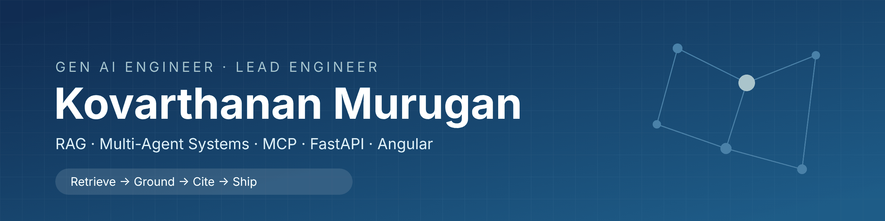

  

  I build AI applications that answer from <b>real documents</b>, show <b>where every answer comes from</b>,
  and run as <b>deployed, cost-controlled products</b>, backed by 10+ years of leading enterprise frontend delivery for BFSI.

  
  
  

---

## 🚀 Featured Build — EPF Mitra

**An AI assistant that answers Employees' Provident Fund questions from official EPFO circulars, with citations and the date of every rule.**
Built in public, one commit a day.

| What | How |
|---|---|
| **Data** | 680+ EPFO circulars and member documents (2000 onwards): polite scraper, incremental downloads, OCR for scanned PDFs, personal-data filtering |
| **Retrieval** | Hybrid BM25 + vector search (Chroma, local `bge-small` embeddings), reciprocal rank fusion, FlashRank re-ranking, "newest version wins" for time-sensitive questions |
| **Answers** | GPT-4o-mini, grounded only in retrieved sources, every claim cited, date of the rule always shown |
| **App** | FastAPI backend (retriever loaded once) + Angular 22 chat UI with citation chips and a "documents up to" freshness label |
| **Cost control** | ~₹0.03 per answer, 10 questions per user per day |

👉 [**epf-mitra**](https://github.com/kovarthanan/epf-mitra) · Live demo: *coming soon*

---

## 🧠 Applied AI & RAG

| Project | Focus |
|---|---|
| [**Hybrid RAG — HR Policy Assistant**](https://github.com/kovarthanan/hybrid-rag-application) | Vector search + Neo4j knowledge graph fused with RRF; FastAPI, guardrails, human-in-the-loop review; Docker + Traefik on a VPS · [Live demo](https://rag.kovarthanan.tech) |
| [**Knowledge Graph — Visual Representation**](https://github.com/kovarthanan/knowledge-graph-visual-representation) | Graph retrieval with a local LLM (Qwen 2.5 via Ollama); an interactive PyVis view shows only the nodes behind each answer |

## 🤖 AI Agents & Automation

| Project | Focus |
|---|---|
| [**CrewAI Customer Support Agent**](https://github.com/kovarthanan/crewai-rag-support-agent) | Three agents: FAISS retrieval, web-search fallback when retrieval is weak, and a logger for every Q&A; Streamlit UI |
| [**HR AutoGen Assistant**](https://github.com/kovarthanan/hr-autogen-assistant) | Microsoft AutoGen (AgentChat) agent that drafts job descriptions and answers HR queries with streaming output |
| [**CrewAI Travel Planner**](https://github.com/kovarthanan/crewai-travel-planner) | Multi-agent trip planner: research and recommendations split across specialised agents |
| [**n8n Slack AI Recipe Bot**](https://github.com/kovarthanan/n8n-slack-ai-recipe-bot) | n8n workflow: a dish name in Slack returns a South Indian–style ingredient list, with a bot-loop guard |

---

## 🛠️ Engineering Approach

**Grounded retrieval · Citations · Guardrails · Evaluation · Human-in-the-loop · Cost tracking · Docker · VPS deployment · Clean frontend UX**

The goal is not only to make the model answer, but to make the whole system **trustworthy, testable, affordable and deployable**.
Lessons I apply: test with trap questions, treat adding data as a possible regression, and put must-have guardrails in code, not only in prompts.

## 🧰 Tech Stack

**AI:** OpenAI API · LangChain · CrewAI · AutoGen · MCP · n8n · Ollama
**Retrieval:** Chroma · FAISS · Neo4j · BM25 · FlashRank · sentence-transformers
**Backend:** Python · FastAPI · Node.js · Express
**Frontend:** Angular (Signals, standalone, new control flow) · TypeScript · RxJS · NgRx · Streamlit
**Ops:** Docker · Traefik · Linux VPS · GitHub Actions · Azure DevOps

## 🎯 Current Focus

- Shipping **EPF Mitra** end to end: evaluation set, RAGAS baseline, public deployment
- Moving RAG workloads to **Azure OpenAI and Azure AI Search**
- Deeper work on **agent workflows** (LangGraph) and **evaluation and observability**

## 💼 Background

Lead Software Engineer for 4 years on Citi's banking and wealth platforms (BFSI): led a team of 4 and built a data-comparison feature that saved bankers about **1,400 hours a year** (Employee of the Month, Nov 2025). 10+ years building data-heavy Angular applications before moving into Gen AI engineering.

---

<i>Learn deeply → build in public → ship with care.</i>

